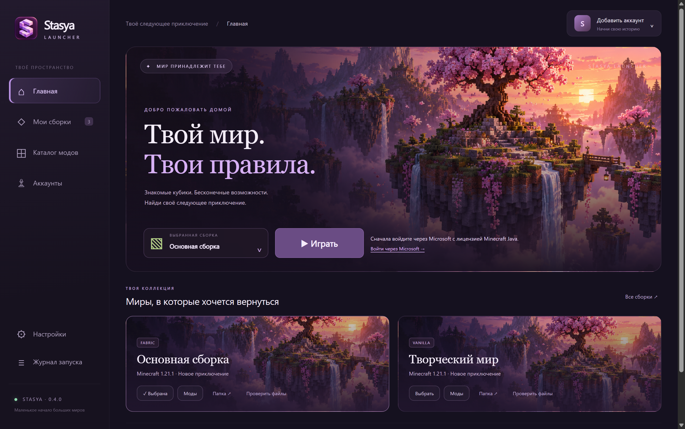
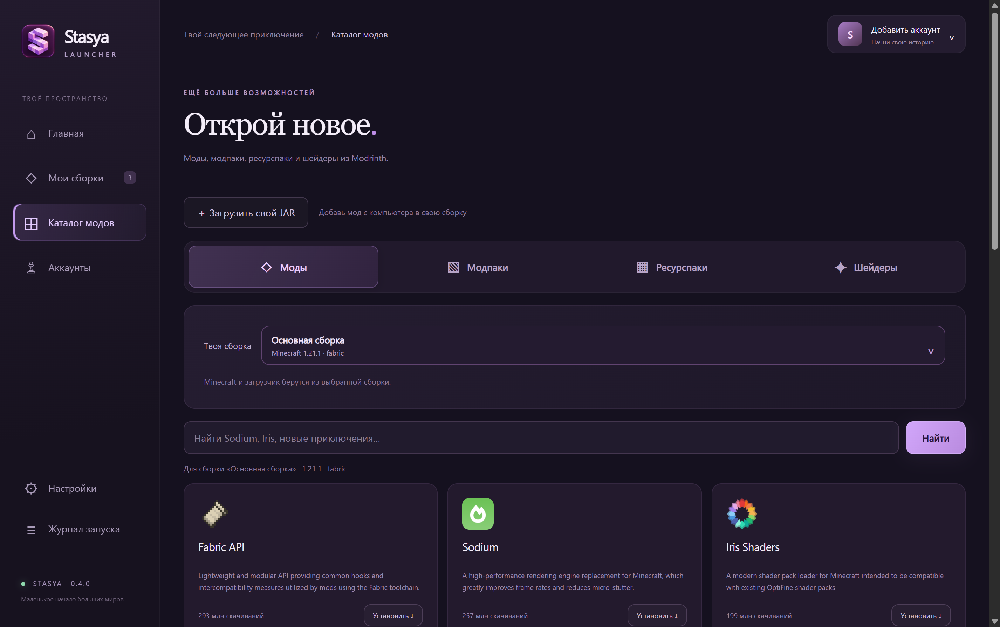
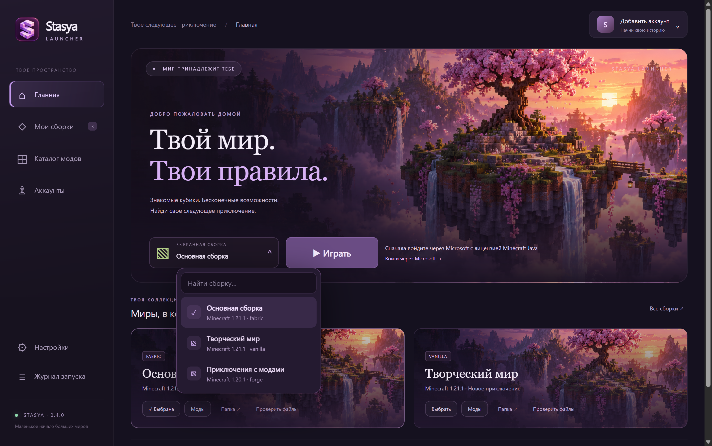

# Stasya Launcher

A Minecraft: Java Edition launcher for Windows x64, with a Russian interface, managed instances, Modrinth browsing and `.mrpack` imports.

**Version 0.4.0.** Mojang AppID approval was confirmed by email on 2026-10-29. The owner has confirmed Microsoft sign-in, a licensed Minecraft launch and joining a multiplayer server. This is user-confirmed testing, not an automated test of the owner’s account.

[Download Windows x64](https://github.com/vorobjewsen30-max/stasya-launcher/releases/tag/v0.4.0) · [Report an issue](https://github.com/vorobjewsen30-max/stasya-launcher/issues) · [Privacy](PRIVACY.md)







## Возможности

- Добавление своих JAR-модов в выбранную сборку, в том числе нескольких файлов сразу. Проверяется архив и описание мода для загрузчика; свои файлы не отправляются на внешние сервисы. Совместимость Minecraft и зависимости своих JAR пользователь проверяет самостоятельно.
- Поиск и переключение сборок через оформленные меню: кликабельна вся кнопка, есть клавиатурное управление и отметка выбранной сборки.

- Вход личным Microsoft-аккаунтом. Авторизация и владение Minecraft Java проверяются перед каждым игровым запуском; при ошибке запуск блокируется.
- Отдельные игровые папки сборок, настройка памяти, журнал и восстановление игровых ресурсов.
- Vanilla, Fabric, Quilt, Forge и NeoForge. Для NeoForge требуется явно указать версию загрузчика; полная матрица сочетаний версий не проверена.
- Автоматическая загрузка Java из Adoptium с проверкой SHA-256; можно указать свой `java.exe`.
- Четыре вкладки Modrinth: моды, модпаки, ресурспаки и шейдеры. Сначала выбери сборку, затем лаунчер автоматически выберет новейшую совместимую версию по дате публикации.
- Все обязательные зависимости из Modrinth, включая вложенные, скачиваются автоматически. Точные версии зависимостей соблюдаются; optional и embedded не скачиваются повторно. Если автор не указал зависимость в API, лаунчер не может вывести её из названия мода.
- Ресурспаки сохраняются в `resourcepacks`, шейдеры — в `shaderpacks` выбранной сборки. Включи их в настройках Minecraft. Для шейдеров нужен Iris или другой совместимый загрузчик.
- Импорт `.mrpack` с проверкой хешей и поддержкой клиентских overrides.
- Читаемая подсказка рядом с «Играть» объясняет, нужно ли войти, создать или выбрать сборку.

## Как запустить

Скачай EXE из Releases и открой его. Node.js для готового приложения не нужен. Войди через Microsoft с лицензией Minecraft Java, создай сборку или импортируй `.mrpack`, выбери её и нажми «Играть». Java и ресурсы загружаются при первом запуске. Minecraft и моды не входят в EXE.

Данные сохраняются в `%APPDATA%/StasyaLauncher/data`. Portable EXE не хранит миры рядом с исполняемым файлом. Перед переносом данных закрой игру и сделай резервную копию. EXE не подписан сертификатом издателя.

## Authentication and API review

The desktop app is a public client using MSAL Node, PKCE and OAuth state validation. It has no client secret. Microsoft token caches are encrypted with Electron `safeStorage` on Windows and never exposed to the renderer. Content and authentication requests go directly to the corresponding services.

Public application (client) ID: `ed79d506-8ce9-4754-abe5-eee153fe6562`.

Redirect URI: `https://login.live.com/oauth20_desktop.srf`.

The flow is Microsoft → Xbox Live → XSTS → Minecraft Services → ownership entitlements → Java profile. Every launch refreshes authentication and checks ownership before downloading/installing the game or spawning its process. There is no gameplay fallback when authentication or ownership fails.

A Minecraft AppID approval request was submitted on 2026-10-27. The owner provided a Mojang approval email dated 2026-10-29 and then confirmed successful Microsoft sign-in, a licensed game launch and multiplayer access.

## Build and verification

Windows x64 and Node.js 22.12+:

```powershell
npm ci
npm test
npm start
npm run build
```

Build output: `release/Stasya-Launcher-0.4.0-Windows-x64.exe`.

Interface check using isolated data:

```powershell
npx electron . --smoke --data-dir=C:/temp/stasya-ui-check
```

See [TESTING.md](TESTING.md) for verified behavior and remaining limitations. Do not use personal game data for automated tests.

## Project and licensing

Source: MIT. Dependencies retain their own licenses. Main projects: [Electron](https://www.electronjs.org/), [XMCL](https://github.com/Voxelum/minecraft-launcher-core-node), [MSAL Node](https://github.com/AzureAD/microsoft-authentication-library-for-js), [Modrinth API](https://docs.modrinth.com/api/) and [Adoptium](https://api.adoptium.net/).

Stasya Launcher is an independent project, not an official Mojang, Microsoft, Xbox or Modrinth product. Minecraft requires a separate valid license. The project does not distribute Minecraft binaries or third-party mods in its releases.

## Store preparation

The release includes a per-user offline NSIS installer and a Store preparation kit with listing drafts, icons, screenshots and a schema-validated WinGet manifest. An unsigned MSIX preview is structurally validated by MakeAppx and kept as a local preparation artifact. This is not Microsoft Store certification or a published WinGet listing. Real Partner Center identity, account verification and certification checks are still required; EXE/MSI Store submission requires valid code signing. See [store/README.md](store/README.md).
